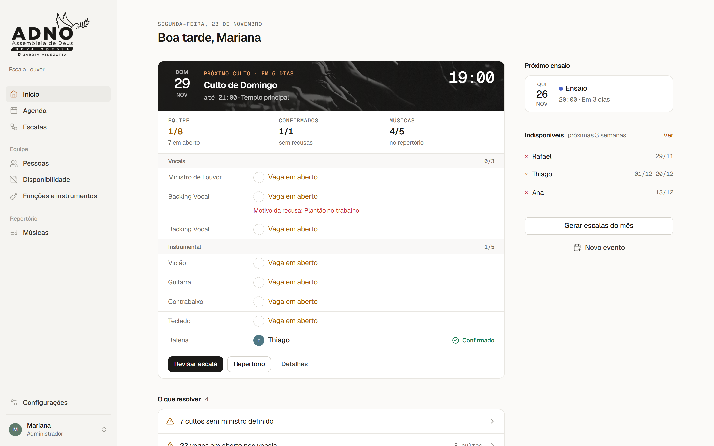
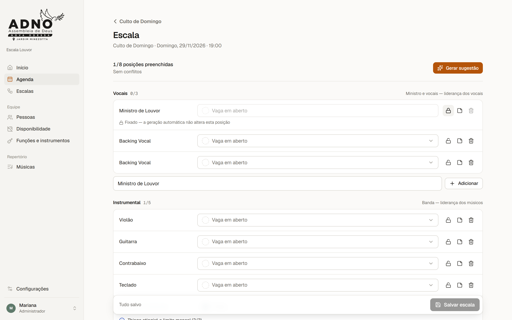
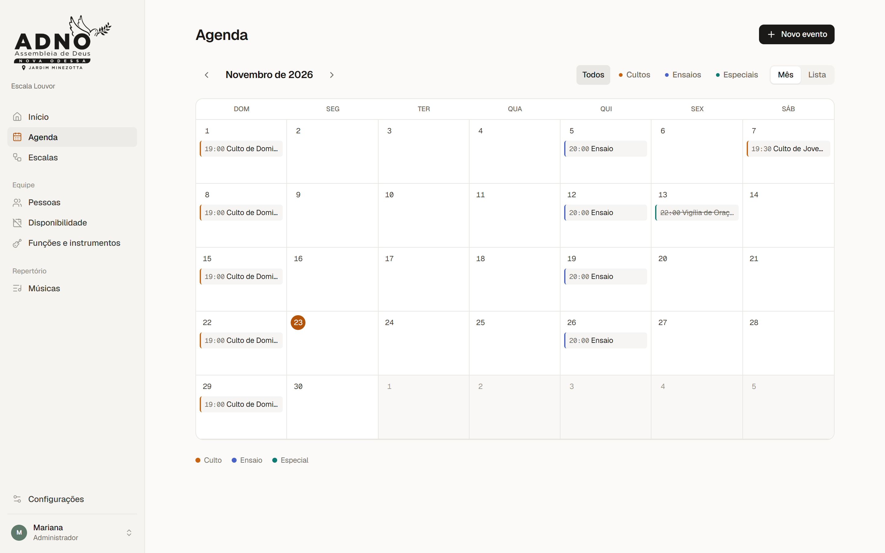
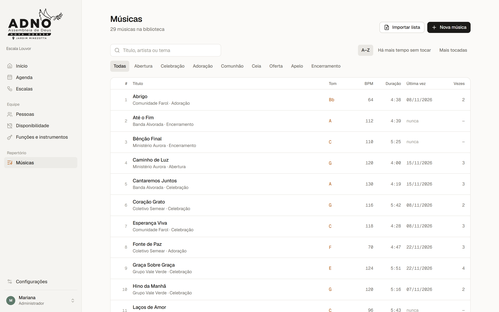
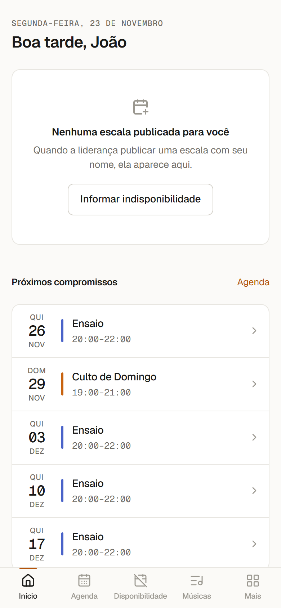

# Escala Louvor

[](https://github.com/samuel-bueno/escala-louvor/actions/workflows/ci.yml)


[](LICENSE)

App web (PWA) que organiza **escalas, disponibilidade e repertório** do ministério de louvor da ADNO (Assembleia de Deus, Nova Odessa · Jardim Minezotta).

**O problema:** montar a escala à mão exige cruzar a disponibilidade, as funções e o rodízio de muita gente, e o repertório de cada culto acaba espalhado.
**A solução:** um app em que a liderança gera a escala com um clique (respeitando disponibilidade, funções e rodízio), revisa, publica, e cada músico confirma ou pede troca pelo celular.

| Início da liderança | Montagem da escala |
|---|---|
|  |  |

| Agenda | Músicas | Celular | Login |
|---|---|---|---|
|  |  |  |  |

> Screenshots geradas com os dados fictícios do seed (`npm run setup`).

## Destaques

- **Geração automática da escala** com filtros (disponibilidade, função, conflito, limite mensal) e pontuação para rodízio justo; cada escolha mostra o "por quê" e nada é salvo sem prévia.
- **Permissões por área** (líder dos músicos, líder dos vocais, membro) conferidas no servidor, com testes de integração que chamam as Server Actions de verdade.
- **Login com senha ou biometria** (passkeys/WebAuthn), convite por link e redefinição de senha por link de uso único.
- **PWA** instalável no celular, com página offline.
- **Segurança:** CSP com nonce, isolamento por organização em todas as consultas, rate limit de login.
- **Qualidade:** TypeScript estrito, testes com Vitest e CI no GitHub Actions (lint, tipos, testes e build a cada push).

## Como o projeto foi construído

Desenvolvi o Escala Louvor para resolver uma necessidade real da minha igreja e usei IA (Claude) como ferramenta de desenvolvimento: para acelerar a escrita de código, revisar decisões e testar fluxos. As decisões de produto, as regras de negócio e a validação com a equipe são minhas, e reviso o que entra no projeto para conseguir explicar cada parte.

---


Aplicativo (PWA) para organizar escalas de ministros e músicos, disponibilidade e repertório de um ministério de louvor. Interface em pt-BR, fuso `America/Sao_Paulo`.

> **Dados de demonstração são FICTÍCIOS** (nomes, e-mails `.test`, músicas, artistas e links `example.com`).

## Stack
Next.js 16 (App Router, Server Actions) · React 19 · TypeScript · Tailwind CSS 4 · Drizzle ORM · SQLite/libSQL (local) → Turso (produção) · Zod · Vitest · ESLint.

## Requisitos
Node.js 20+ e npm.

## Instalação e desenvolvimento
```bash
npm install
cp .env.example .env
npm run setup        # migrations + dados fictícios
npm run dev          # http://localhost:3000
```
Acessos demo (senha `demo1234`, só com `DEMO_MODE=true`): `lider@exemplo.test` (liderança), `joao@exemplo.test` (ministro), `daniel@exemplo.test` (músico).

## Banco de dados
- Schema: `src/server/db/schema.ts`; migrations versionadas em `drizzle/` (`npm run db:generate` após alterar o schema, `npm run db:migrate` para aplicar).
- `npm run db:seed` só roda em banco vazio e é bloqueado em produção (exceto `ALLOW_SEED=true`).
- `npm run db:reset` apaga e recria **apenas** banco local (`file:`).
- Local e produção usam o mesmo motor (SQLite/libSQL) — sem divergência de SQL.

## Variáveis de ambiente
| Variável | Uso |
|---|---|
| `DATABASE_URL` | `file:./data/escala.db` local; `libsql://...turso.io` em produção |
| `DATABASE_AUTH_TOKEN` | token do Turso (só produção) |
| `DEMO_MODE` | mostra contas demo no login (`false` em produção) |
| `APP_URL` (reserva) | URL pública, usada nos links compartilháveis |
| `ALLOW_SEED` | permite seed em produção (padrão `false`) |

## Testes e qualidade
```bash
npm test            # unitários + integração (permissões por papel, recorrência, duas igrejas)
npm run lint
npm run typecheck
npm run build
npm run smoke       # com o servidor rodando: telas, autorização por papel e isolamento entre igrejas
```

## Deploy sugerido (custo inicial zero)
- **Vercel Hobby** (app Next.js) + **Turso Free** (banco). A Vercel usa o script `vercel-build`, que aplica as migrations no Turso antes de cada build — não é preciso rodar `db:migrate` à mão. O `vercel.json` fixa as funções em São Paulo (`gru1`), perto do banco Turso em `sa-east-1`.
- Limitações: Vercel Hobby é para uso não comercial; para crescer, Vercel Pro (~US$20/mês) ou qualquer host Node (Render, Railway, VPS). Migrar para Postgres é viável com Drizzle (troca de dialeto + migrations).

## Colocar no ar (passo a passo)
1. **Banco (Turso, grátis):** crie conta em turso.tech, crie um banco e gere a URL (`libsql://...`) e um token.
2. **Aplicar o schema no Turso** (no seu computador):
   ```bash
   DATABASE_URL="libsql://SEU-BANCO.turso.io" DATABASE_AUTH_TOKEN="SEU-TOKEN" npm run db:migrate
   ```
3. **Criar a igreja e o seu acesso de administrador** (sem dados fictícios):
   ```bash
   DATABASE_URL="libsql://SEU-BANCO.turso.io" DATABASE_AUTH_TOKEN="SEU-TOKEN" ORG_NAME="Nome da Igreja" ADMIN_NAME="Seu Nome" ADMIN_EMAIL="seu@email.com" ADMIN_PASSWORD="uma-senha-longa" npm run bootstrap
   ```
4. **Site (Vercel, grátis):** suba o código para um repositório privado no GitHub, importe-o na Vercel e defina as variáveis: `DATABASE_URL`, `DATABASE_AUTH_TOKEN`, `DEMO_MODE=false`, `APP_URL=https://seu-app.vercel.app`.
5. Abra o endereço e entre com o administrador. Em **Pessoas → Convites**, crie um link de convite e envie no grupo: cada membro se cadastra sozinho (nome, e-mail, instrumentos, senha) e você aprova. Para promover alguém a líder, edite a pessoa e escolha o perfil "Liderança". Quem esquecer a senha pede um link ao líder (perfil da pessoa → "Link de nova senha").

## iPhone
- **Opção A – Safari:** abra a URL e faça login.
- **Opção B – PWA (recomendado):** Safari → Compartilhar → **Adicionar à Tela de Início**. Abre em tela cheia (standalone), com ícone, safe areas e página offline.
- **Opção C – App Store (futuro):** empacotar a PWA (ex.: Capacitor) ou criar app Expo reutilizando `src/domain` (algoritmos puros, sem dependência de UI). Exige conta Apple Developer (US$ 99/ano).
- Limitações da PWA no iOS: push só com app instalado (iOS 16.4+) e requer backend VAPID (não implementado); armazenamento pode ser limpo pelo sistema; sem acesso a recursos nativos avançados.
- **Offline:** abre o app e páginas já visitadas; salvar/publicar/confirmar exigem internet. Service worker só em produção (`npm run build && npm start`).

## Estrutura
```
src/domain/        regras puras e testáveis (datas, geração de escala, alertas, repertório, recorrência, importação)
src/server/db/     schema e conexão
src/server/auth/   senha (scrypt), sessões, tokens
src/server/queries leitura de dados
src/server/actions server actions (validação Zod + autorização em cada uma + auditoria)
src/features/      componentes por domínio (escala, repertório, pessoas, músicas, configurações)
src/components/    design system (botões, campos, dialog, toast, badges) e layout
src/app/           rotas (App Router)
scripts/           migrate, seed, reset, smoke, ícones
```

## Papéis e permissões

**Papel no sistema ≠ função musical.** O papel diz *quem pode editar o quê*; a função diz *o que a pessoa toca ou canta*. Ser guitarrista não torna ninguém líder dos músicos: a liderança é marcada explicitamente no perfil (Pessoas → editar → Acesso → Papel no sistema) e pode acumular.

| | Administrador | Líder dos músicos | Líder dos vocais | Membro |
|---|---|---|---|---|
| Escala **instrumental** | editar | **editar** | ver | ver (publicada) |
| Escala **vocal** (ministro, vocais) | editar | ver | **editar** | ver (publicada) |
| Posições **técnicas** (som, projeção) | editar | ver | ver | ver |
| **Repertório** do culto (ordem, tom, observação) | editar | ver | **editar** | ver |
| Biblioteca de músicas (cadastrar/importar) | sim | não | sim | só consulta |
| Publicar a escala para confirmação | sim | sim | sim | não |
| Cultos/eventos (criar, editar, cancelar, concluir, apagar) | sim | não | não | não |
| Pessoas, funções, configurações, convites | sim | não | não | não |
| Ver indisponibilidade da equipe | com motivo | só datas | só datas | só a própria |
| Confirmar/recusar a **própria** escala; informar a **própria** indisponibilidade | sim | sim | sim | sim |

- **Fonte única:** `src/domain/permissions.ts`. A área de cada posição vem de `functions.kind` (`minister`/`vocal` → vocal; `instrument` → instrumental; `tech` → técnica), nunca do nome da função.
- **Aplicado no servidor:** `saveScheduleAction` compara a escala salva com a enviada e recusa qualquer alteração, adição ou remoção em área que o usuário não lidera; a geração automática e a aplicação da prévia fazem a mesma checagem; repertório e músicas usam `assertCanEditSetlist`. Esconder o botão na tela é só conveniência. Cobertura: `src/server/actions/permissions.test.ts` (chama as Server Actions de verdade, com duas igrejas).
- **Sempre há um administrador:** não é possível rebaixar ou desativar o último.
- **Menor privilégio:** líderes veem *que* alguém está indisponível, não o motivo; o texto do motivo da recusa também fica só com a administração.

### Convidado (músico de fora)
Em qualquer posição da escala, "Convidado (músico de fora)" preenche a vaga só com o nome (`event_slots.guest_name`): sem cadastro, sem acesso ao app, fora dos limites mensais e dos conflitos. Entra como confirmado e a geração automática nunca o altera. Aparece como "convidado" na equipe, no link público e na prévia.

### "Preciso trocar"
O músico toca em **Preciso trocar** na própria escala, pode sugerir um colega livre e com a mesma função (a lista só mostra nomes) e escrever um motivo. A liderança da área vê "pediu troca · sugeriu X" e aceita com um toque (**Aceitar sugestão**): a pessoa sugerida assume a posição e passa a aguardar confirmação. Reaproveita o fluxo de recusa (avisos, Home e publicação continuam funcionando). Servidor: `respondToSlotAction`, `listSwapCandidatesAction`, `acceptSwapSuggestionAction` (migração `0004`).

### Foto de fundo (tela do músico)
O destaque da "próxima escala" usa fundo escuro com a pomba da ADNO. Para usar uma foto da igreja (pessoas adorando): coloque o arquivo em `public/brand/` e defina `heroImage` em `src/config/app.ts` (ex.: `"/brand/adoracao.jpg"`). A foto vira preto e branco sob um véu escuro para o texto sempre ler bem.

### Publicação e mudanças entre lideranças
- Escala **totalmente vazia nunca é publicada** (servidor). Parcial: pede confirmação e lista o que falta.
- O repertório guarda **quem alterou e quando** (`events.setlist_updated_at/by`); a escala e o detalhe do culto mostram "atualizado há X por Y", e a liderança dos músicos vê "Repertório ainda não finalizado pela liderança vocal" sem ser bloqueada.
- Escala publicada que muda volta a "aguardando confirmação".

## Entrar com Face ID / digital (passkeys) e salvar senha
- **Login por biometria:** padrão WebAuthn (passkeys), biblioteca `@simplewebauthn`. A pessoa ativa uma vez por aparelho (aviso na Home ou **Mais → Entrar com biometria**) e depois entra com o rosto ou a digital, sem digitar e-mail nem senha. Só a **chave pública** fica no banco (`passkeys`); a privada nunca sai do aparelho. O botão só aparece em aparelhos que têm biometria.
- **Servidor:** exige verificação do usuário (biometria/PIN do aparelho), confere origem e domínio, usa desafio de uso único com validade de 5 min (`passkey_challenges`), limita tentativas por IP, recusa contas inativas e cada pessoa remove só os próprios aparelhos. O login por senha continua funcionando como alternativa (nunca é a única porta).
- **Atenção ao domínio:** a passkey fica ligada ao endereço do site. Se o endereço mudar, é preciso ativar de novo (a senha continua valendo). O mesmo vale para o endereço de preview da Vercel, que é outro domínio.
- **Salvar senha:** o campo de e-mail usa `autocomplete="username"` e o de senha `current-password`, que é o que o Chrome e o Chaveiro do iPhone esperam para oferecer salvar e preencher.
- **Testes:** unitários e de servidor em `passkey-utils.test.ts` e `passkeys.test.ts`; a cerimônia completa (ativar, entrar, remover, recusar) foi exercitada no Chromium com autenticador virtual, em desenvolvimento e em produção (`next start`). Migração `0005`.

## Banco de dados (Vercel + Turso)
`DATABASE_URL` = `libsql://NOME-DO-BANCO-SUA-ORG.turso.io` (um endereço só, sem aspas nem espaços) e `DATABASE_AUTH_TOKEN` = token do Turso (`turso db tokens create NOME-DO-BANCO`). Marque as duas para **Production e Preview** e faça Redeploy depois de mudar. O app confere as duas ao iniciar (`src/server/db/config.ts`): se houver dois endereços colados, espaço, aspas, falta do token ou variável ausente na Vercel, o build falha com uma mensagem clara (sem mostrar o valor), em vez de cair em silêncio para um arquivo local que perde os dados.

## Links de convite, senha e escala
Os links são montados com o endereço em que a administração está usando o app (não dependem da variável `APP_URL`), então continuam certos se o domínio mudar. `APP_URL` só vale como reserva e precisa ser **apenas o domínio**, ex.: `https://adno-louvor.vercel.app` (sem barra no meio, sem caminho, um único endereço).

## Segurança
- **CSP com nonce** por requisição em `src/proxy.ts`: scripts só `'self'` + nonce (`strict-dynamic`), sem `unsafe-inline`/`unsafe-eval` em produção, `frame-ancestors 'none'`, `object-src 'none'`, sem terceiros. `style-src` mantém `'unsafe-inline'` porque o app usa `style=""` (tamanhos de avatar/barras); estilo inline não executa código. Verificado em `next start`: página interativa, 13/13 scripts com nonce e nenhuma violação.
- Cabeçalhos: HSTS (Vercel), `X-Frame-Options`, `nosniff`, `Referrer-Policy`, `Permissions-Policy`.
- Toda consulta filtra por `organization_id`; testado com duas igrejas (testes de integração e smoke).

## Cultos de domingo e eventos extras

- Todos os domingos até **31/12/2027** são programados automaticamente como "Culto de Domingo" (série recorrente). A geração é idempotente: um índice único (organização + série + data) impede duplicação, e domingos já cadastrados à mão são respeitados.
- Cada data da série é um culto normal: escala, funções, repertório, observações e ensaio vinculado. Uma data pode ser editada individualmente ou **cancelada** (não apagada) sem afetar a série.
- Horário/local padrão da série: Configurações → Cultos e séries → Editar série (aplica às datas futuras que ainda seguem o horário antigo).
- Eventos extras (quarta, vigília, conferência…) são opcionais: Agenda → **Novo evento**, com repetição opcional semanal ou mensal.

## Design

Design system em `src/app/globals.css`: Geist (UI) + Geist Mono (datas, horários, tom, BPM), base neutra quente, ação principal em tinta neutra e um único acento (latão) para estado ativo, links e "próximo". Categorias da agenda: culto (latão), ensaio (ardósia), especial (petróleo). Modo escuro em 4 níveis de superfície, sem preto puro. Componentes base em `src/components/ui`.

## Algoritmo de distribuição ("aleatoriedade inteligente")
Para cada posição, em ordem cronológica e começando pelas funções com menos candidatos:
1. **Filtros obrigatórios:** ativo, tem a função/instrumento cadastrado, disponível, não está em outra posição do mesmo culto, sem conflito de horário, limite mensal (quando obrigatório), máximo no período.
2. **Pontuação:** participações no mês e no lote, intervalo desde a última, culto consecutivo, limite como preferência, instrumento principal, dias habituais.
3. **Sorteio apenas entre empatados**, com RNG com seed (reproduzível).
Fixados nunca mudam; vagas sem candidato ficam vazias com aviso; toda escolha tem explicação ("Por quê?"). Nada é salvo sem prévia, e substituir alguém já escalado exige confirmação explícita. O repertório segue a mesma ideia (frescor + nº de execuções + tema, intervalo mínimo, parcial com aviso).

## Status das funcionalidades
**Implementado:** login com sessões e autorização no servidor; cadastro de membros por link de convite com aprovação do líder; redefinição de senha por link de uso único gerado pelo líder; participantes com múltiplas funções/instrumento principal/limite/indisponibilidade; funções extensíveis; compromissos (CRUD, status, cancelamento preservando histórico, recorrência simples); escala manual com alertas (erro/aviso/info), fixação, duplicar anterior; geração automática por culto e em lote com prévia editável; confirmação/recusa pelo membro; biblioteca de músicas, categorias, importação em lote com prévia; gerador de repertório com reordenação (arrastar + setas); histórico de execução; dashboard; agenda (lista no celular, calendário no desktop); link público com token revogável; auditoria básica; tema claro/escuro; PWA.

**Preparado para o futuro (modelo pronto, sem tela):** multi-igreja (`organization_id` em tudo), conteúdo por instrumento (`song_resources.function_id`), tom usado por culto (transposição), repertórios para vários cultos (`generateSetlistsForPeriod`).

**Próxima evolução (estrutura já preparada):** aviso "N músicas mudaram depois da última confirmação da escala" (hoje há só "atualizado por/quando"); cifra transposta, áudio no tom do culto e player de estudo (o tom por culto já é guardado em `setlist_items.key`); regras por área para posições técnicas.

**Roadmap:** notificações (push/e-mail/WhatsApp), recuperação de senha por e-mail, exportação de dados pessoais (LGPD), indisponibilidade recorrente, cifras/PDFs/uploads, app nativo.

## Limitações conhecidas
- Não testado em iPhone físico. O fluxo principal (cadastro → escala gerada e ajustada → repertório → publicação → confirmação pelo membro) foi executado no navegador em viewport emulado de 375px, com interações disparadas via DOM. Ausência de overflow horizontal verificada por medição em 320, 768, 1024 e 1440px.
- Sem recuperação de senha por e-mail: o líder gera um link de nova senha no perfil da pessoa e envia por WhatsApp. Para e-mail automático seria preciso um serviço de envio (ex.: Resend) com chave de API.
- Rate limit de login é simples (banco), sem CAPTCHA.
